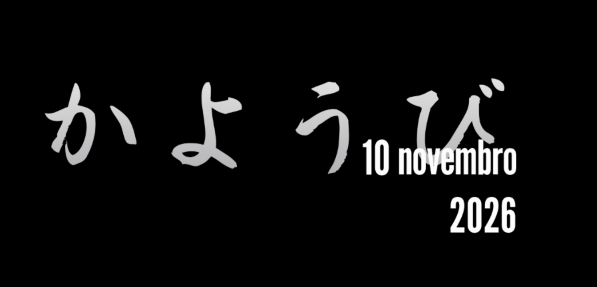
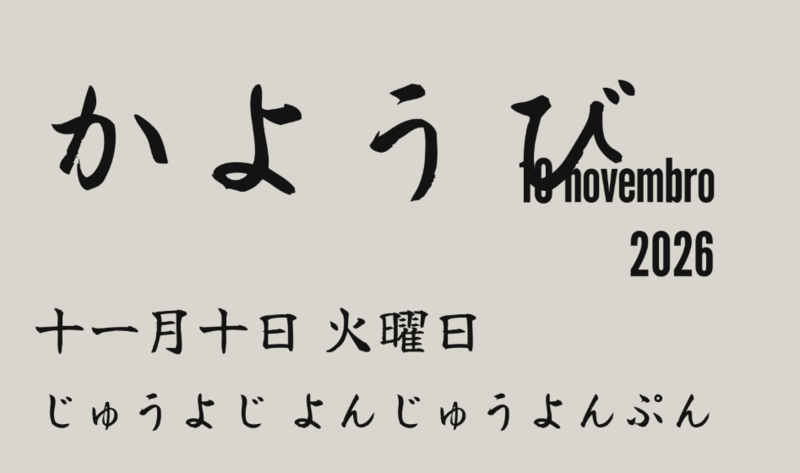

# Hiragana Clock

Extensão do GNOME Shell que coloca na área de trabalho um widget com o dia da semana escrito em **hiragana**, acompanhado da data e, se você quiser, da data em kanji e da hora em hiragana.





A ideia veio do widget *Hiragana Calendar* do KDE Plasma (de zayronXIO), que não tem versão para o GNOME. Daquele widget veio só o conceito: o código daqui foi escrito do zero.

## Funcionalidades

- Dia da semana em hiragana (げつようび, かようび…), grande, numa fonte de pincel.
- Dia, mês e ano numa fonte estreita, sobrepostos ao final do dia da semana.
- Opcional: data em kanji (`十一月十日 火曜日`) e hora em hiragana (`じゅうよじ にじゅっぷん`), em 24h ou 12h (ごぜん/ごご).
- Três cores: **prateado** (com degradê), **branco** e **preto**.
- **Arraste com o mouse** para qualquer lugar da tela, ou escolha uma das 9 posições fixas.
- Clique com o botão direito no widget para abrir as preferências.
- Opção de esconder o relógio padrão do painel superior.

As leituras irregulares do japonês são tratadas uma a uma: dias como ついたち, はつか e じゅうよっか, horas como よじ e くじ, e minutos como いっぷん e じゅっぷん. Os testes conferem os 31 dias do mês, as 24 horas e os 60 minutos.

## Requisitos

- GNOME Shell **50** ou **51** (Wayland).
- As fontes padrão do widget, ambas com licença livre OFL:
  - [Yuji Syuku](https://fonts.google.com/specimen/Yuji+Syuku), a fonte de pincel do hiragana e do kanji;
  - [League Gothic](https://fonts.google.com/specimen/League+Gothic), a fonte estreita da data.

  Sem elas, o widget usa fontes reserva. Você também pode escolher outras fontes nas preferências.

### Instalar as fontes (Fedora)

O Fedora traz a League Gothic como pacote. A Yuji Syuku não está nos repositórios, então ela vai para a pasta de fontes do seu usuário:

```bash
sudo dnf install tlomt-league-gothic-fonts
```

```bash
mkdir -p ~/.local/share/fonts/yuji-syuku
curl -L -o ~/.local/share/fonts/yuji-syuku/YujiSyuku-Regular.ttf \
  https://raw.githubusercontent.com/google/fonts/main/ofl/yujisyuku/YujiSyuku-Regular.ttf
fc-cache -f
```

## Instalação a partir do código

```bash
git clone https://github.com/viniciusbispo19/hiragana-clock.git
cd hiragana-clock
glib-compile-schemas hiragana-clock@viniciusbispo19.github.io/schemas/
mkdir -p ~/.local/share/gnome-shell/extensions
ln -s "$PWD/hiragana-clock@viniciusbispo19.github.io" ~/.local/share/gnome-shell/extensions/
```

No Wayland, o GNOME Shell só procura extensões novas quando a sessão começa. Saia da sessão, entre de novo e ative a extensão:

```bash
gnome-extensions enable hiragana-clock@viniciusbispo19.github.io
```

## Desenvolvimento

O módulo de conversão (`hiragana.js`) não depende do GNOME, então os testes rodam direto no terminal:

```bash
cd hiragana-clock@viniciusbispo19.github.io
gjs -m tests/test-hiragana.js
```

Para testar a extensão sem sair da sua sessão, use uma sessão aninhada. No Fedora, ela precisa do pacote `mutter-devkit`:

```bash
dbus-run-session gnome-shell --devkit --wayland
```

Para ver os erros da extensão na sessão normal:

```bash
journalctl -f -o cat /usr/bin/gnome-shell
```

O código tem comentários em português que explicam o porquê de cada decisão, inclusive algumas armadilhas do St e do Clutter encontradas nos testes.

## Licença

[GPL-2.0-or-later](LICENSE), a mesma licença do GNOME Shell.

As fontes Yuji Syuku e League Gothic não fazem parte deste repositório. Elas são distribuídas pelos seus autores sob a SIL Open Font License.
